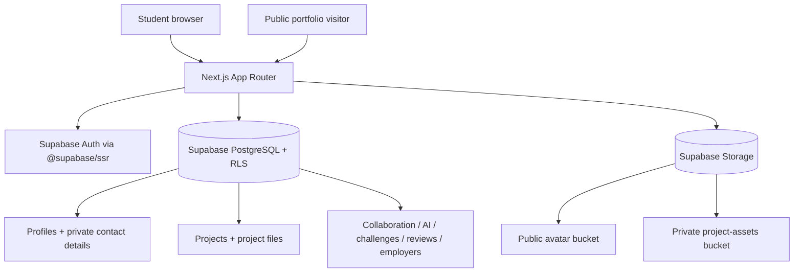
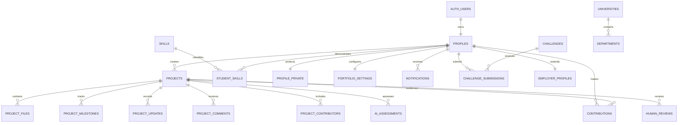

# WaleWorks AI — Architecture and product boundaries

## Product model

WaleWorks is evidence-first. The core unit is a student-owned project repository. The profile provides identity and context; the project record provides problem, process, skills and outcomes; attachments provide supporting evidence; visibility settings determine what can be shared.

## Application boundary

## Core relationships

## Permission model

| Resource | Anonymous visitor | Authenticated owner | Other authenticated user |
|---|---|---|---|
| Public profile | Read filtered fields through `public_profiles` | Read/update own profile | Read filtered fields if public |
| Private contact email | Never | Read/write through `profile_private` | Never |
| Public project | Read | Read/update/delete own | Read |
| Unlisted project | Public API-readable by UUID; not a confidentiality control | Read/update/delete own | Public API-readable by UUID |
| Private project | No | Read/update/delete own | No |
| Project evidence | Read only when the project is public/unlisted and signed URL can be created | Read/upload/delete own | No access to private project files |
| AI assessment | No access | Read own | No access |
| Human review | No access | Read reviews attached to own projects | Read only own authored reviews |

An unlisted project is not confidential and its rows are still readable through the public database API; the identifier is not an access password. It is hidden from the owner's portfolio listing, but must not be used for sensitive work. Use `private` for work that must not be visible to other users.

## Important invariants

1. A new Auth account is provisioned as a `student` by a database trigger. The browser cannot promote itself to mentor, employer or administrator.
2. The public portfolio reads from a restricted, security-barrier view. Base profile rows are owner-only. The view nulls academic fields and empties skills, achievements or certifications when the matching portfolio section is hidden, so these hidden values are filtered before the API returns them. Contact email is stored in a separate owner-only table and only appears in the public view when `show_email` is true. Structured skill records, AI assessments and human reviews remain owner/reviewer-only until safe public summaries and consent rules are implemented.
3. Project assets live in a private bucket. The storage path includes both the owner UUID and project UUID, and policies validate both.
4. AI assessment records are not writable by browser clients and are owner-only for reads. A future AI endpoint must validate the owner, retrieve project context server-side, call the LLM without exposing credentials, save the result with model/rubric metadata, and show the AI disclaimer.
5. Human review records are private to the project owner and reviewer in the MVP. A trusted, invitation-aware review process must be responsible for creating reviews and verifying them.
6. Public profile visibility and project visibility are independent. A public project is not exposed on a portfolio if the owner profile is private. Project pages still remain accessible through their own public URLs when project visibility is public.
7. User-submitted external links are checked in the form and checked again before rendering. Notifications can only link to same-origin application paths.
8. Project invitation records can be created only in the pending state by a project owner. No browser update policy allows an owner to self-assert that an invitee accepted; Phase 2 must implement consent-aware acceptance.

## Phase boundaries

- **Phase 1:** account, profile, portfolio, repository, project documentation, files and visibility.
- **Phase 2:** accepted contributor membership, invitation email delivery, contribution event capture, milestones and comments with project-team RLS.
- **Phase 3:** AI documentation transformations, skills extraction and rubric assessments with model provenance and separate human review status.
- **Phase 4:** verified challenge publishers, submissions, employer verification, search indexes and student-controlled professional discovery.
